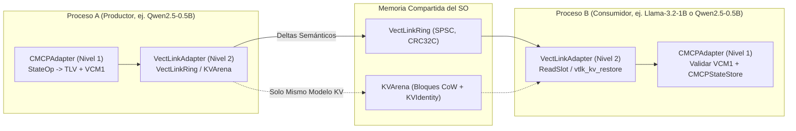

# VectLink-CMCP

**Integración experimental implementada de memoria compartida en dos niveles que combina CMCP (Nivel 1: estado semántico) y Vect-Link (Nivel 2: memoria de inferencia KV) para sistemas multiagente con LLMs locales.**

> **Estado del Proyecto:** Implementado y evaluado (`main`). Los dos repositorios originales — [Cross-Model-Context-Protocol](https://github.com/Santirobm/Cross-Model-Context-Protocol) y [Vect-Link](https://github.com/Santirobm/Vect-Link) — permanecen independientes y sin modificaciones. La integración es **opcional**: CMCP puede utilizar IPC convencional (sockets/pipes) cuando los payloads semánticos son pequeños.

---

## 1. Arquitectura

- **CMCP — Capa de Contexto Semántico (`cmcp_adapter.py`):** Estado semántico estructurado, transferencia incremental (TLV + sobre `VCM1` + CRC32C), invalidaciones/tombstones, reconstrucción histórica (`checkout_seq`) y comunicación entre arquitecturas distintas.
- **Vect-Link — Capa de Memoria de Inferencia (`vectlink_adapter.py`, `csrc/vl_cmcp_kv_bridge.c`):** Transporte SHM `VectLinkRing`, almacenamiento CoW `KVArena`, reutilización de KV entre procesos compatibles y validación estricta de identidad del modelo y entorno (`KVIdentity`).

---

## 2. Resultados Reportados (Benchmarks Propios en CPU)

Mediciones en Windows 10 Pro x64, Intel Core i5-13500 (solo CPU, `threads=4`, decodificación greedy). Ver [FINAL_INTEGRATION_REPORT.md](FINAL_INTEGRATION_REPORT.md).

- **Transferencia semántica (`n = 50` escenarios `eval` × 3 reps, `Llama-3.2-1B`):**
  - `cmcp_inc_vectlink`: **0,257 ms** de IPC y **3.243,2 ms** E2E (`0,22` EM).
  - `cmcp_inc_socket` (TCP loopback): **0,312 ms** de IPC y **3.245,2 ms** E2E (`0,22` EM).
  - Diferencia E2E de apenas **0,06%** (`-2,06 ms`). Para deltas pequeños (`~352 B`), IPC convencional alcanza.
- **Reutilización KV `Qwen2.5-0.5B -> Qwen2.5-0.5B` entre 2 procesos OS (3 reps):**
  - `prefill`: de **422,5 ms** (`A_cold_full_history`) a **122,5 ms** (`D_cmcp_kv_reuse`, `-71,0%`).
  - `TTFT`: de **634,1 ms** a **300,6 ms** (`-52,6%`).
  - `E2E`: de **1.355,1 ms** a **1.053,3 ms** (`-22,3%`, restauración de `1,29 MB` en `0,853 ms`).
- **Rechazo explícito cross-arch:** La restauración KV `Qwen2.5-0.5B -> Llama-3.2-1B` es rechazada por `vtlk_kv_restore()` (`KV restore/identity check failed`).
- **Ejemplo multiproceso y tests:** Demo real en 2 procesos ([two_process_multiagent.py](examples/two_process_multiagent.py)), `ctest` Release (`1/1`) + ASan/UBSan (`1/1`), `pytest` (`16/16`).

---

## 3. Enlaces y Versión en Inglés

- **English README (Primary):** [README.md](README.md)
- **Informe Final:** [FINAL_INTEGRATION_REPORT.md](FINAL_INTEGRATION_REPORT.md)
- **Repositorios Originales:** [Cross-Model-Context-Protocol](https://github.com/Santirobm/Cross-Model-Context-Protocol) | [Vect-Link](https://github.com/Santirobm/Vect-Link)
- **Licencia:** Apache License 2.0 — [LICENSE](LICENSE) y [NOTICE](NOTICE).
