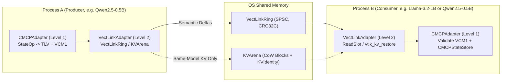

# VectLink-CMCP

**An implemented two-level shared-memory integration combining CMCP (Level 1 semantic state) and Vect-Link (Level 2 inference KV memory) for multi-agent local LLM systems.**

> **Project Status:** Implemented & benchmarked (`main`). Both upstream projects — [Cross-Model-Context-Protocol](https://github.com/Santirobm/Cross-Model-Context-Protocol) and [Vect-Link](https://github.com/Santirobm/Vect-Link) — remain independent and unmodified. Integration is **optional**: CMCP can operate over conventional IPC (sockets/pipes) for small semantic payloads without requiring Vect-Link.

---

## 1. Architecture



### Two-Layer Responsibilities
- **CMCP — Semantic Context Layer (`src/vectlink_cmcp/cmcp_adapter.py`):** Structured semantic state (`facts`, `entities`, `relations`, `decisions`, `constraints`), incremental delta serialization (TLV + `VCM1` versioned envelope + CRC32C), invalidations/tombstones, historical `checkout_seq()`, and cross-model communication (`R3` XML-lite).
- **Vect-Link — Inference Memory Layer (`src/vectlink_cmcp/vectlink_adapter.py`, `csrc/vl_cmcp_kv_bridge.c`):** Shared-memory `VectLinkRing` transport, `KVArena` Copy-on-Write block storage, inter-process KV state restoration (`llama_state_seq_get_data` / `set_data`), and strict model/environment identity validation (`KVIdentity` / `KVModelSpec`).

---

## 2. Capabilities & Compatibility

| Capability | Status | Scope / Notes |
|---|---|---|
| **Cross-process CMCP semantic transfer over `VectLinkRing`** | **Implemented** | Validated with `VCM1` envelope + CRC32C, idempotency, tombstones, and `checkout_seq` |
| **Multi-reader & restart recovery via `KVArena`** | **Implemented (SHM)** | Requires active SHM handle on Windows (`l3_dir` not exposed in Python `KVArena.create`) |
| **Same-model two-process KV reuse** | **Implemented** | Verified on `Qwen2.5-0.5B -> Qwen2.5-0.5B` via `vl_cmcp_kv_bridge.exe` |
| **Cross-architecture KV reuse** | **Explicitly Rejected** | Blocked by `vtlk_kv_restore()` and `assert_kv_compatible()` (`Qwen -> Llama` rejected) |

---

## 3. Experimental Results (Self-Hosted CPU Benchmarks)

All measurements were collected on Windows 10 Pro x64, Intel Core i5-13500 (CPU-only, `threads=4`, greedy decoding). See [FINAL_INTEGRATION_REPORT.md](FINAL_INTEGRATION_REPORT.md) and [docs/benchmarks/INTEGRATION_BENCHMARK_METHODOLOGY.md](docs/benchmarks/INTEGRATION_BENCHMARK_METHODOLOGY.md).

### 3.1 Semantic Context Transfer (`n = 50` `eval` scenarios × 3 reps, `Llama-3.2-1B`)
| Method | Wire Bytes | IPC (ms) | Input Tokens | Prefill (ms) | E2E Mean (ms) | Exact Match |
|---|---:|---:|---:|---:|---:|---:|
| `full_history_socket` (Loopback TCP) | 791.0 | **0.088** | 275.4 | 998.5 | 3,604.2 | **0.54** |
| `cmcp_inc_socket` (Loopback TCP) | **352.4** | 0.312 | **184.8** | 666.5 | 3,245.2 | 0.22 |
| `cmcp_inc_vectlink` (SHM Ring) | **352.4** | 0.257 | **184.8** | **664.2** | **3,243.2** | 0.22 |

* **Finding:** For `~352 B` semantic deltas, Vect-Link SHM reduces IPC latency from `0.312 ms` to `0.257 ms`, yielding only a **`0.06%` E2E difference** (`-2.06 ms` out of `3,245 ms`). Conventional IPC is sufficient for pure semantic text handoffs.

### 3.2 Same-Model KV Reuse (`Qwen2.5-0.5B-Instruct-Q4_K_M.gguf`, 2 OS processes, 3 reps)
| Condition | Restore (ms) | Prefill (ms) | TTFT (ms) | E2E (ms) | KV Bytes |
|---|---:|---:|---:|---:|---:|
| `A_cold_full_history` | 0.000 | 422.5 | 634.1 | 1,355.1 | 0 |
| `B_vectlink_kv_full` | 0.831 | 152.3 | 326.3 | **1,007.6** | 1,169,108 |
| `C_cmcp_prefill` | 0.000 | 398.1 | 582.7 | 1,301.5 | 0 |
| `D_cmcp_kv_reuse` | 0.853 | **122.5** | **300.6** | 1,053.3 | 1,292,108 |

* **Cross-Arch Rejection:** Attempting `Qwen2.5-0.5B -> Llama-3.2-1B` KV restoration failed cleanly with `KV restore/identity check failed` (exit code 11).

---

## 4. Known Limitations

- **No End-to-End Zero-Copy for Text Context:** `CMCPStateStore.render_for_llm()` serializes text for tokenization/prefill; `llama.cpp` also copies restored KV bytes into its private `llama_context` buffers internally.
- **Small-Payload IPC Overhead:** `Vect-Link` SHM does not meaningfully accelerate `< 1 KB` semantic deltas over TCP/pipes.
- **Turn 8 `Llama-3.2-1B` Accuracy:** On composite Turn 8 queries, `cmcp_inc_*` scored `0.22` EM vs `0.54` for `full_history_socket` on `Llama-3.2-1B` (while `Qwen2.5-0.5B` improved in CMCP 2.2b).
- **Windows SHM Lifetime:** Kernel SHM objects close when the last handle closes; Python `KVArena.create` does not expose `Vect-Link`'s C `l3_dir` disk persistence.

---

## 5. Building, Testing & Examples

```bash
# 1. Build C11 KV bridge & C unit tests (Release + ASan/UBSan)
cmake -S . -B build -G Ninja -DCMAKE_BUILD_TYPE=Release
cmake --build build
ctest --test-dir build --output-on-failure

cmake -S . -B build-san -G Ninja -DCMAKE_BUILD_TYPE=Debug \
  -DVCMCP_BUILD_KV_BRIDGE=OFF \
  -DCMAKE_C_FLAGS="-fsanitize=address,undefined -fno-omit-frame-pointer"
cmake --build build-san
ctest --test-dir build-san --output-on-failure

# 2. Run Python integration tests (13 Phase 2 + 3 Phase 3 KV-compatibility tests)
pytest tests/ -v

# 3. Run real 2-process OS multi-agent demo (Qwen2.5-0.5B + Llama-3.2-1B)
python examples/two_process_multiagent.py

# 4. Run benchmarks
python benchmarks/run_phase3_kv_reuse.py
python benchmarks/run_phase4_comparative.py --split eval --reps 3
```

---

## 6. Documentation & Upstream Links

- **Final Report:** [FINAL_INTEGRATION_REPORT.md](FINAL_INTEGRATION_REPORT.md)
- **Architecture & Audits:** [INTEGRATED_MEMORY_ARCHITECTURE.md](docs/architecture/INTEGRATED_MEMORY_ARCHITECTURE.md) | [INTEGRATION_COMPATIBILITY_AUDIT.md](docs/audit/INTEGRATION_COMPATIBILITY_AUDIT.md) | [INTEGRATION_BENCHMARK_METHODOLOGY.md](docs/benchmarks/INTEGRATION_BENCHMARK_METHODOLOGY.md) | [INTEGRATION_AUDIT_REPORT.md](docs/audit/INTEGRATION_AUDIT_REPORT.md)
- **Upstream Projects:** [Cross-Model-Context-Protocol (CMCP)](https://github.com/Santirobm/Cross-Model-Context-Protocol) | [Vect-Link](https://github.com/Santirobm/Vect-Link)
- **Spanish Version:** [README.es.md](README.es.md)
- **License:** Apache License 2.0 — [LICENSE](LICENSE) & [NOTICE](NOTICE).
